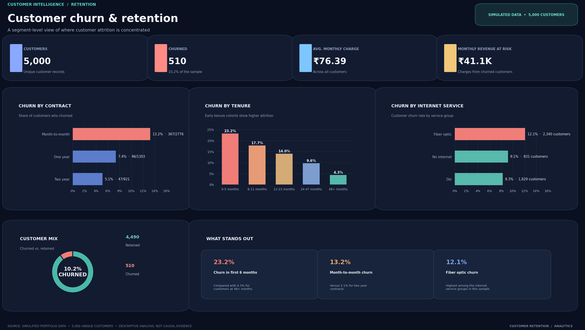

# Customer Churn & Retention Analytics

This project looks at customer churn in a simulated subscription dataset. The aim is to understand how churn differs across customer groups and to bring the main findings together in a Power BI dashboard.

## Dataset

The original file contains 5,030 rows. After removing repeated customer IDs, the analysis uses 5,000 customer records. The data includes customer tenure, contract type, internet service, payment method, monthly charges, support tickets, AutoPay and churn status.

The dataset is simulated and does not contain real customer records.

## What I worked on

### 1. Data cleaning with Python

`Customer_Churn_Analysis.py` reads the raw customer file and prepares it for analysis. It:

- removes repeated records using `customer_id` and keeps the first record;
- trims spaces and standardises category names;
- fills missing `total_charges` using monthly charges multiplied by tenure;
- fills missing support-ticket counts using the median;
- groups customers into tenure bands; and
- saves the cleaned file and summary tables in an `analysis_output` folder.

### 2. Data cleaning and business queries with SQL

`Customer_Churn_Analysis.sql` contains the MySQL work from the raw table through to the business queries. It creates the database and raw table, checks the source data, removes duplicate customer IDs, standardises category values, fills missing values and creates `customers_clean`.

The queries then answer these questions:

1. How many customers are active, retained or churned, and what is the churn rate?
2. Which contract type has the highest churn rate?
3. At what stage of tenure is churn highest?
4. How does churn differ by internet service?
5. Which payment method has the highest churn rate?
6. How does churn compare between customers using AutoPay and those who are not?
7. What monthly charges are associated with customers who have churned?
8. Which retained customers have had at least two support tickets in the last 90 days and may need a follow-up?

**To run the SQL file:** open it in MySQL Workbench and run the database and `customers_raw` table creation section first. Import `data/customers_raw.csv` into the `customers_raw` table using the Table Data Import Wizard. Then run the remaining checks, cleaning query and business queries.

### 3. Power BI dashboard

The Power BI report brings the results together in one page. It includes:

- total customers, churned customers, average monthly charge and monthly charges associated with churned customers;
- churn comparisons by contract type, tenure band and internet service;
- a retained-versus-churned customer split; and
- a small set of key segment observations.

The report uses the cleaned customer data. The `dashboard_preview.png` file is a static image for viewing the design on GitHub. The `.pbix` file can be opened in Power BI Desktop for the interactive report.

## A few observations

- 5,000 unique customers remain after removing repeated IDs.
- 510 customers are marked as churned, which is 10.2% of the cleaned dataset.
- Month-to-month customers have a churn rate of 13.2% in this sample.
- The 0–5 month tenure group has a churn rate of 23.2%.
- The fiber-optic group has a churn rate of 12.1%.
- Monthly charges associated with churned customers total about ₹41.1K.

These figures describe this simulated dataset. They do not show that any one factor caused a customer to leave.

## Main files

| File | Purpose |
|---|---|
| `Customer_Churn_Analysis.py` | Python data cleaning and customer churn summaries. |
| `Customer_Churn_Analysis.sql` | MySQL data preparation and business analysis queries. |
| `dashboard_preview.png` | Static dashboard preview for this GitHub page. |
| `data/customers_raw.csv` | Original simulated customer data. |
| `data/customers_clean.csv` | Cleaned customer data used for the analysis and dashboard. |
| `data/data_dictionary.csv` | Description of the dataset fields. |
| `Customer_Churn_Retention_Dashboard.pbix` | Interactive Power BI report, saved from Power BI Desktop. |

## Tools

Python (pandas), MySQL and Power BI Desktop.
